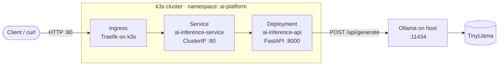

# AI Inference Platform on Kubernetes

A self-hosted LLM inference API that serves the **TinyLlama** model through a **FastAPI** service, containerized with **Docker** and deployed on a lightweight **k3s** Kubernetes cluster. Model inference is handled by **Ollama**, and traffic reaches the API through a Kubernetes **Ingress**.

The project shows the core pieces of running an AI model behind a production-style API: containerization, Kubernetes workloads, service discovery, ingress routing, and configuration through environment variables.

---

## Architecture



**Request flow**

1. A client sends a prompt to the cluster's ingress.
2. The Ingress routes the request to the `ai-inference-service` Service.
3. The Service forwards it to the FastAPI pod on port `8000`.
4. FastAPI sends the prompt to Ollama's `/api/generate` endpoint.
5. Ollama runs TinyLlama and returns the generated response.

---

## Tech Stack

| Layer | Technology |
|---|---|
| API | Python 3.11, FastAPI, Uvicorn, Pydantic |
| Model serving | Ollama, TinyLlama |
| Containerization | Docker (`python:3.11-slim` base image) |
| Orchestration | k3s (lightweight Kubernetes) |
| Networking | Kubernetes Service (ClusterIP) and Ingress |

---

## Project Structure

```
ai-inference-platform-kubernetes/
├── app/
│   ├── main.py             # FastAPI application and endpoints
│   └── requirements.txt    # Python dependencies
├── k8s/
│   ├── deployment.yaml     # API Deployment (1 replica, OLLAMA_URL env var)
│   ├── service.yaml        # ClusterIP Service (port 80 -> 8000)
│   └── ingress.yaml        # Ingress routing / to the Service
├── Dockerfile              # Container image for the API
└── README.md
```

---

## API Endpoints

| Method | Endpoint | Description |
|---|---|---|
| `GET` | `/` | Confirms the platform is running |
| `GET` | `/health` | Health check, returns `{"status": "healthy"}` |
| `POST` | `/ask` | Sends a prompt to TinyLlama and returns the model's response |
| `GET` | `/docs` | Interactive Swagger UI (built into FastAPI) |

**Example request**

```bash
curl -X POST http://<node-ip>/ask \
  -H "Content-Type: application/json" \
  -d '{"prompt": "Explain Kubernetes in one sentence."}'
```

---

## Getting Started

### Prerequisites

- Docker
- k3s (includes `kubectl` and the Traefik ingress controller)
- [Ollama](https://ollama.com) installed on the host machine

### 1. Start Ollama and pull the model

```bash
ollama pull tinyllama

# Listen on all interfaces so pods in the cluster can reach it
OLLAMA_HOST=0.0.0.0 ollama serve
```

### 2. Run the API locally (optional)

```bash
cd app
pip install -r requirements.txt
OLLAMA_URL=http://localhost:11434/api/generate uvicorn main:app --reload
```

Then open http://localhost:8000/docs to try the endpoints.

### 3. Build the Docker image

```bash
docker build -t ai-inference-api:v1 .
```

### 4. Load the image into k3s

The Deployment uses `imagePullPolicy: Never`, so the image must already exist in the k3s container runtime:

```bash
docker save ai-inference-api:v1 | sudo k3s ctr images import -
```

### 5. Deploy to Kubernetes

```bash
kubectl create namespace ai-platform
kubectl apply -f k8s/
```

### 6. Verify the deployment

```bash
kubectl get pods,svc,ingress -n ai-platform
curl http://<node-ip>/health
```

---

## Configuration

| Variable | Default | Description |
|---|---|---|
| `OLLAMA_URL` | `http://host.docker.internal:11434/api/generate` | Ollama generate endpoint |

In Kubernetes, `OLLAMA_URL` is set in `k8s/deployment.yaml` to `http://172.17.0.1:11434/api/generate`, the Docker bridge address of the host where Ollama runs. Update it to match your environment.

---

## Skills Demonstrated

- Packaging a Python API into a minimal Docker image
- Writing Kubernetes Deployment, Service, and Ingress manifests
- Routing external traffic into a cluster with an Ingress controller
- Connecting containerized workloads to an external model server
- Configuring applications with environment variables instead of hardcoded values
- Serving an open-source LLM locally without paid APIs

---

## Roadmap

- [ ] Run Ollama inside the cluster as its own Deployment with a PersistentVolume for model storage
- [ ] Add liveness and readiness probes using the `/health` endpoint
- [ ] Set CPU and memory requests and limits
- [ ] Move configuration into a ConfigMap
- [ ] Add request timeouts and error handling for Ollama failures
- [ ] Add a Horizontal Pod Autoscaler
- [ ] Add a CI/CD pipeline with GitHub Actions to build and test the image
- [ ] Add monitoring with Prometheus and Grafana

---

## Author

**Paul Momo** · [GitHub](https://github.com/mopaul873)
